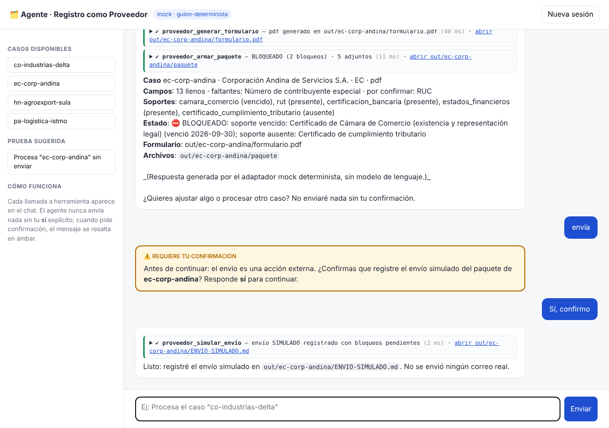

# Reto 01 · Agente conversacional "Registro como Proveedor"

Agente que lee una solicitud de registro como proveedor, llena el formulario desde el repositorio maestro (xlsx, pdf o valores para un portal), arma el paquete para firma y **pide confirmación explícita** antes de cualquier acción externa.



Construido con la metodología **ASDD (Agentic Specification-Driven Development)**: ver [`specs/`](specs/README.md). La solución se explica en [`SOLUCION.md`](SOLUCION.md).

## Arranque en local (un comando)

Requisitos: [Bun](https://bun.sh) ≥ 1.1.

```bash
cp .env.example .env          # pon tu ANTHROPIC_API_KEY (opcional: sin clave arranca con el adaptador mock)
bun install && bun run dev    # http://localhost:3000
```

Con Docker: `docker build -t agente-proveedor . && docker run -p 3000:3000 --env-file .env agente-proveedor`

## Verificación sin modelo

```bash
bun install && bun run demo.ts
```

Ejecuta las 5 herramientas sobre los 4 casos, más un caso inexistente, una ruta maliciosa, un envío sin confirmación y un envío confirmado. Relee el xlsx generado para comprobar las celdas y verifica que `modulo/` esté en sincronía. Termina con `✅ Todas las verificaciones pasaron` (código de salida 0). Limpia `out/` al inicio.

`bun run typecheck` compila en modo estricto (sin `any`).

## Variables de entorno

| Variable | Requerida | Descripción |
|---|---|---|
| `ANTHROPIC_API_KEY` | Sí, para el modelo real | Solo en el backend. Nunca llega al front, a los logs ni a la API. |
| `LLM_PROVIDER` | No | `anthropic` (por defecto si hay clave), `openai` (cualquier API compatible) o `mock` |
| `LLM_MODEL` | No | Por defecto `claude-sonnet-5-5` |
| `OPENAI_API_KEY`, `OPENAI_BASE_URL` | No | Para el adaptador compatible con OpenAI |
| `MAX_ITERACIONES` | No | Tope herramienta→modelo por turno (25) |
| `MAX_TOKENS_SESION` | No | Presupuesto de tokens por sesión (200000) |
| `LLM_TIMEOUT_MS` | No | Timeout al proveedor (60000) |
| `ACCESS_KEY` | No | Si se define, el chat exige esta clave (campo en el panel izquierdo) |
| `FECHA_EJECUCION` | No | `YYYY-MM-DD` para evaluar vigencias; por defecto, hoy |
| `TZ` | No | `America/Bogota` |

## API

| Método | Ruta | Descripción |
|---|---|---|
| `POST` | `/api/chat` | `{ sessionId, message }` → `{ ok, reply, toolCalls[], needsConfirmation, usage }` (header opcional `x-access-key`) |
| `GET` | `/api/sessions/:id` | Historial visible de la sesión |
| `GET` | `/api/health` | `{ ok, provider, model, protegido }`, sin claves |
| `GET` | `/api/casos` | Casos disponibles |
| `GET` | `/api/out/<caso>/[archivo]` | Lista o descarga los artefactos generados (protegido contra path traversal) |

## Link de prueba

**URL:** https://agente-registro-proveedor-tw35.onrender.com · **Clave de acceso:** se entrega por correo (campo "clave de acceso" en el panel izquierdo)

> Plan gratuito de Render: si el servicio estuvo inactivo, la primera petición puede tardar ~50 s en despertar.

Despliegue en Render: *New → Blueprint →* seleccionar este repo (usa `render.yaml` + `Dockerfile`) y cargar `ANTHROPIC_API_KEY` en el panel.

Prueba sugerida (sesión nueva):

```
Procesa el caso "ec-corp-andina". Dime qué campos quedaron llenos, cuáles
faltan, si el paquete está listo para firma y qué soportes debo actualizar.
No envíes nada todavía.
```

Luego escribe `envía`: el agente pide confirmación (resaltada en ámbar). Responde `sí` y se escribe solo `out/ec-corp-andina/ENVIO-SIMULADO.md`.

## Estructura

```
agent/prompt.md                  comportamiento (system prompt)
src/knowledge/                   conocimiento: registro-proveedor.md + reglas.json
src/tools/                       ejecución: proveedor.ts (herramientas), dominio.ts, generadores.ts, registro.ts
src/agent/ciclo.ts               ciclo del agente (tope, confirmación, presupuesto)
src/llm/                         adapter.ts (interfaz) + anthropic.ts, openai.ts, mock.ts
src/server.ts                    API HTTP (Bun)
web/index.html                   front de chat
modulo/                          bonus: agente empaquetado (generado con `bun run modulo`)
specs/                           rastro ASDD: intent → spec → validación → diseño → plan → verificación
fixtures/                        entregados por Periferia (sin modificar)
demo.ts                          verificación sin modelo
```
